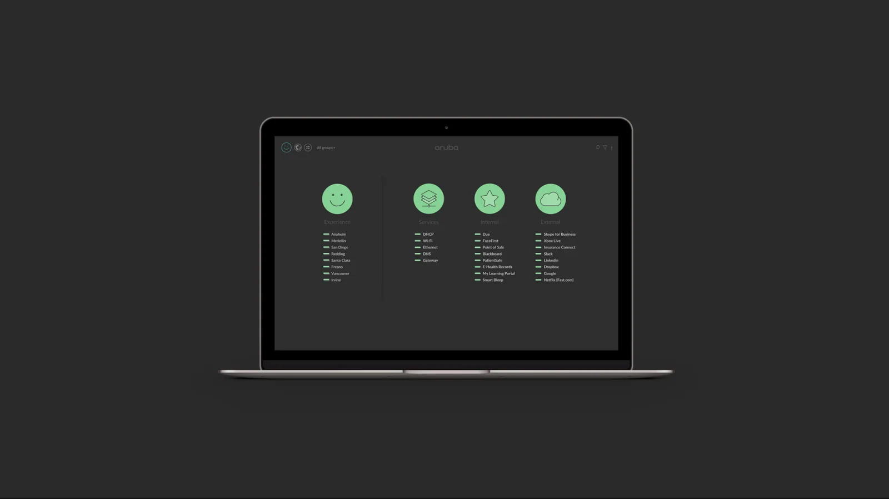
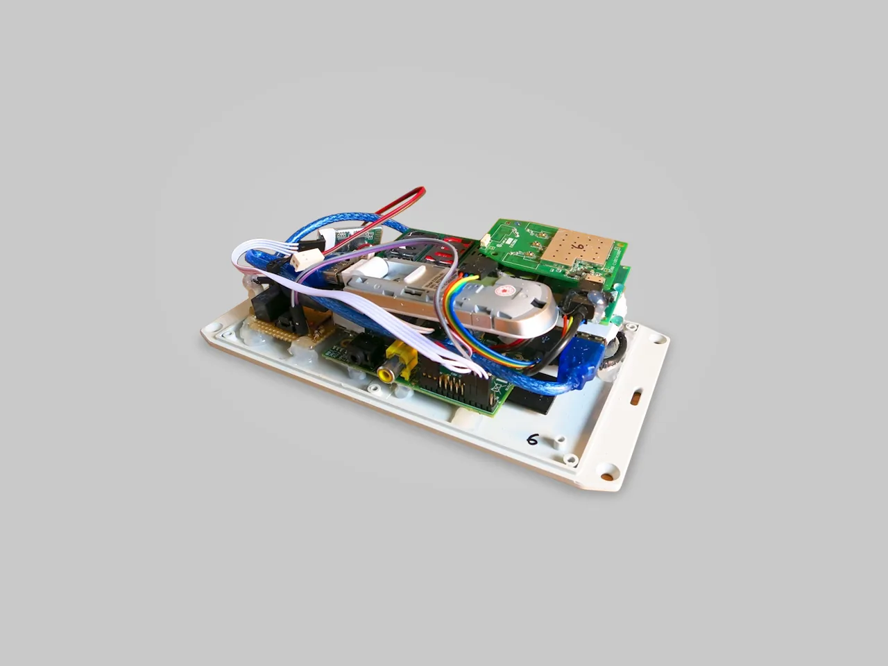
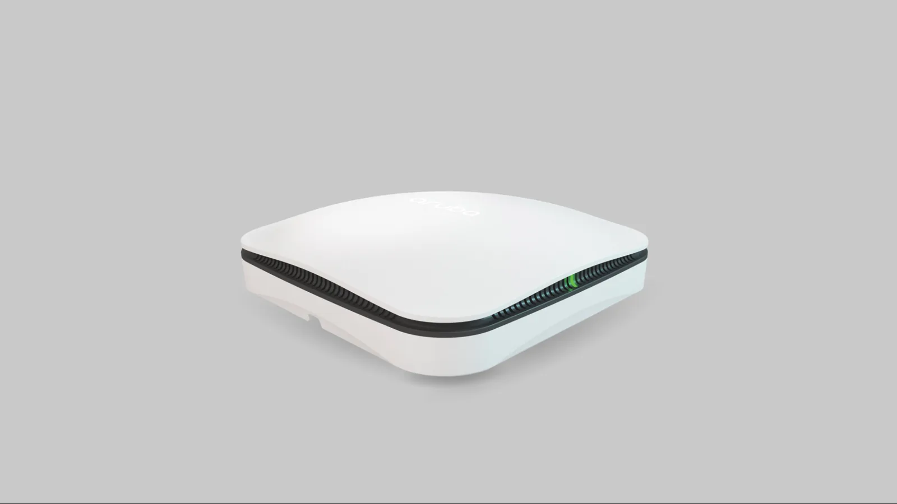
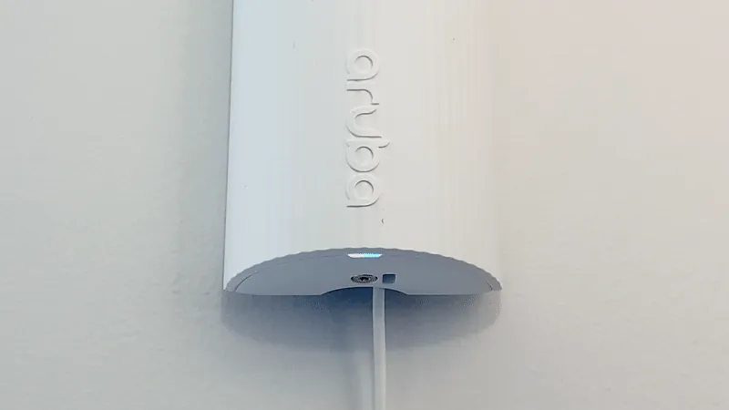
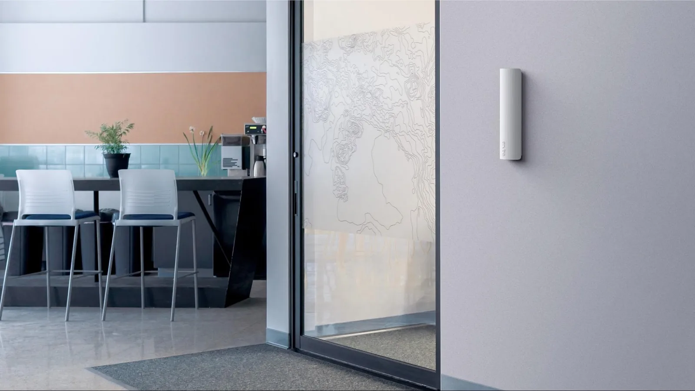
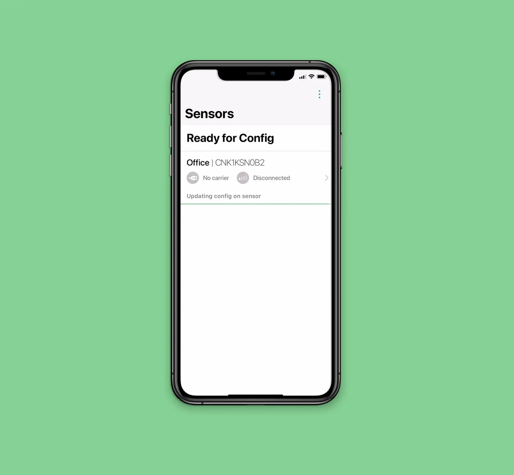
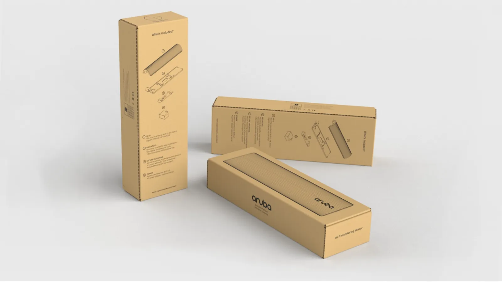

# Aruba Sensors: Behind the Scenes

*21 min read*

*Originally published on the Aruba blog in 2020.*

Building a technology product is a bit like making a movie. A skilled team spends months or years pouring their energy and creativity into something to captivate and delight others. Both journeys are deeply technical, creative, and collaborative.

I love watching making-of documentaries to see how movies are made. What were the major challenges? Important decisions? Critical turning points?

This is a peek behind the scenes at how our team designed two new products, the [Aruba G-Series Sensors](https://blogs.arubanetworks.com/solutions/g-series-sensors-for-user-experience-insight), which are radically different from their predecessor. Why did we build these products the way we did? What problems were we solving? What obstacles almost stopped us in our tracks?

---

## 1. Starting up

Two years ago Cape Networks [joined](https://news.arubanetworks.com/press-release/hpe-acquire-cape-networks) Aruba and became Aruba User Experience Insight (UXI). We founded Cape to solve the problem of measuring wireless and wired end-user experience for IT organizations, and joined Aruba to scale our solution worldwide.

### An army of automated Wi-Fi & app testers

Are applications like Zoom, Slack, and Teams performing well for end-users? It’s hard for IT teams to tell. They need to investigate vague complaints like “the Wi-Fi sucks” by testing in person, which is time consuming or not even possible.

Our solution would consist of cloud-based analysis and visualization of data collected by on-premise sensors. Sensors, in the networking world, are “automated users”. They connect to any network, just like you or I would, to measure application performance first-hand.

At the time, existing sensor products were so clunky and complicated that most IT teams ignored them or even tried to build their own. We were determined to do better.

### Two bets

We formed two contrarian hypotheses for how we’d tackle the problem:

**1. Simplicity:** Many enterprise networking products are built by network experts for other network experts who relish complexity. We bet against that—there are many more networks out there than network experts. And in any case, who has the time to learn another complex product? Ours had to be super simple, even fun.

**2. Zero touch deployment:** Installing new networking devices is a major project. Engineers often pre-configure devices, ship them to local technicians who lay cables in hard to reach places and then install, validate, and maybe reconfigure the devices in person. Would IT teams do all that for a startup’s unproven product after they’ve already installed their network? Our sensors needed to be extremely easy to deploy—more like plugging in a toaster than setting up a network.

At that point, prospective customers were mostly unconvinced. “Easy to use and deploy? We’ve heard that one before…” Others told us they wanted more complexity and flexibility—not simplicity!

We were betting our limited time and resources on defying conventional wisdom.

### Version one

We built an ultra-simple dashboard—without metrics or charts on the main page—laser-focused on two questions: Is everything ok? If not, what’s wrong?

A green smiley face means everything is good. Intuitive actions—hovering and clicking to drill down—reveal more and more detailed charts, data, and insights.

We set a new standard, which competitors now imitate down to our colors and formatting.

*Dashboard reimagined: ultra simple to learn and use.*

We also asked ourselves: what would be the simplest and most awesome way to deploy sensors? Mail the sensor to a location, have someone plug it into power… and then it magically configures itself. No complex installation needed.

We worked backwards from the experience we’d defined. Each sensor has a cellular modem. We pre-installed SIM cards and managed connectivity ourselves—harder for us, but easier for customers. Adhesive backing meant tool-free mounting. Simple web-based onboarding and in-product chat made the sensors easy to configure.

### Exponential growth

The products proved so easy to set up and use that customers often ordered five sensors… then twenty… then hundreds or thousands more. Betting on those two contrarian hypotheses paid off.

Last year sales grew 1,800%. Our sensors execute almost half a billion tests per day. Our products are now used by thousands of retailers, banks, healthcare providers, governments, service providers, and others in 80 countries.

[IMAGE MISSING]
*Chart: Number of sensors online each month over a three-year period (scale withheld).*

### New sensors, new decisions

To build our first sensor in record time, we'd used components that locked us into one-sided relationships with suppliers—a reasonable trade-off for a scrappy startup. Newly armed with Aruba's scale and supply chain, redesigning the electronics became a priority. We launched a project to create new sensors: the G-Series.

But why stop at the electronics? We dug into feedback from existing customers and potential customers: what were their underlying problems? What solutions could we build that would have the biggest impact on their problems and aligned with or even improved on our product vision?

Our analysis led to three major decisions:

First, we’d double down on the simplicity and ease of installation that customers loved about our first sensor. That meant developing more mounting options, including for electrical boxes, rail mounts, and more.

Second, we'd build two new sensor models, including one without expensive cellular connectivity—ideal for areas without coverage or for “densifying” large campus deployments—while somehow keeping the same “zero touch deployment” we’d pioneered using cellular. That would give our customers more options at different price points.

Third, we’d improve the industrial design so that the sensor blended into more environments. We needed to rethink how the sensor looked.

---

## 2. What should a sensor look like?

In the early days, we realized few sensible IT organizations would want to install an unproven startup's "mystery hardware" on their mission critical networks. This became obvious when we showed our early prototype sensors, assembled by hand in our basement, to potential customers…

*Stay away from this early sensor prototype.*

We needed to “convince” my co-founder's barber with a bottle of scotch to let us install our prototype sensor in his store for our first shopping mall deployment!

Scotch isn’t exactly a scalable strategy. How could we get IT organizations to trust our hardware? Investing in strong security for the sensors was critical, but not enough. They had to look unassuming.

### Disguised as an AP

There was no established design language for a sensor, and as a tiny team we lacked the time to create one. Instead, we opted for a “disguise”: our sensor would look like a device our customers were already buying by the thousand—a Wi-Fi Access Point (AP).

Designing our first sensor to be reminiscent of an AP was the right decision at the time. To our customers, it felt immediately familiar and trustworthy. And it allowed us to move quickly.

*The F-Series Sensor looks familiar... a bit like a Wi-Fi Access Point.*

However, there were unintended consequences. This design meant some customers saw an AP’s inherent limitations and overlooked our sensor’s additional capabilities, for example:

- It is a powerful computer with the space and memory to run a full Linux stack including a web browser: it’s a real client device.
- The built-in cellular connectivity, which can save time, cost, and effort during installation and network outages.
- Additional functionality like "last gasp" backup power to differentiate power outages from network outages.

Most importantly, to me at least, was that APs are designed to be mounted on ceilings, out of sight. Sensors on the other hand are meant to be installed on walls, tables, and pillars—alongside where people work, learn, and carry out their day-to-day lives. Sensors should be respectful co-inhabitants of our spaces.

### Adopting a beginner's mind

To design the best sensor we could, we had to approach the challenge armed with the lessons we'd learned over the years and an open mind.

It was fun to imagine all the potential designs the new sensor could have, but we forced ourselves to focus on the problem, not the solution. On a clean sheet of paper, we asked ourselves: what would make the design a success?

- **Great RF performance**: a beautiful sensor would be pointless without solid Wi-Fi, LTE, and Bluetooth.
- **Flexible to install**: customers should be able to install sensors anywhere quickly and securely—walls, pillars, junction boxes, desks, or even ceilings and temporary stands if necessary. Cashiers, nurses, receptionists and other non technicians should be able to do it.
- **Fit any space**: sensors should feel at home in high-end retailers, clinics, heritage buildings, sleek offices, airport lounges... or anywhere else.
- **Fade into the background**: sensors are typically mounted 4-5 feet high and need to share a space with people safely and without calling attention to themselves...
- **... and yet be distinctive**: who would be excited about an anonymous lump of plastic?

Our design motto became: "Ambient, yet excellent."

[IMAGE MISSING]
*Sensors need to feel at home in any space. We reviewed retail, healthcare, transit and many other kinds of environments to understand where sensors would “live.”*

### An elegant solution

We worked with our partners at Bould Design to research and explore different directions for the industrial design.

[IMAGE MISSING]
*Some industrial design directions we considered.*

Clarity about our design goals allowed us to quickly decide on a "column" form factor, which provided an elegant solution to all our requirements:

- The column's length provides great antenna separation for strong RF performance.
- It can be mounted in either orientation depending on whether cables come from below (default) or above.
- The width is the same as a standard electrical outlet box—perfect for mounting.
- The neutral marble white color and matte finish help it blend in almost anywhere.
- The "architectural" shape feels solid and unobtrusive—familiar, but unlike other boxy networking products.
- The subtle fluting adds character, softens what could be an overly imposing shape, and hints at the activity within.

Someone recently asked me: why didn’t you choose a more conventional, rectangular shape? Wouldn’t that be more functional? It’s true that it would have been easier to engineer the electronics to fit into a box shape, but that wouldn’t have solved the design problems we had recognized as important.

*Aruba UXI G-Series sensor.*

Early on, before we'd settled on the column design, I brought home a box filled with foam mockups of potential form factors. They were to help us see how different shapes might look and feel when mounted on a wall. When I turned away, my two-year-old started digging through the box. The column was neither the most familiar shape, nor the most exotic. But that was the one she grabbed, and slapped against the nearest wall. Probably a good sign!

[IMAGE MISSING]
*Column form factor: toddler approved.*

### Ambient yet excellent

We spent months finessing the industrial design in concert with the electronic, thermal, RF, and mechanical designs. The final size, form, finish, and details needed dozens of iterations to get just right.

[IMAGE MISSING]
*The design team refined the column shape to make it more elegant and distinctive, and later to accommodate thermal, RF, mechanical, and electrical engineering considerations. Pictured here is one weeks’ progress early in the project.*

A good example is the subtle status LED. Recessed in the sensor’s chin it usually glows a gentle white. It is in fact two separate LEDs, which allows the sensor to display simple or complex states. White means online; half white and half blue means online and Bluetooth active. If you’re using the companion Aruba UXI app (more on that in a minute) you can tap“identify me” on any sensor to activate a colorful rainbow effect on the LEDs. This rainbow mode helps when the sensor is mounted and its serial number is out of view. It’s also just plain fun.

*A prototype of “rainbow mode” to identify sensors from the Aruba UXI app.*

Due to practical limitations, the LEDs themselves are almost three inches away from where they appear, connected to the outside by flowing plastic “light pipes”. Sophisticated software simulated how light would travel through different curving shapes. After months of simulating, prototyping, and refining the shape and material we were able to minimize light “leakage” and maximize brightness. Even with their geometry perfected, the two pipes refract light slightly differently. To make each LED look the same, we set each LED to a fractionally different color. To compensate for a faint bleed between the light pipes, we tweaked every color so they look the same no matter which other color they’re paired with.

My favorite details are the ones nobody will notice until they need them—or hopefully won’t notice at all because they seem completely natural.

[IMAGE MISSING]
*The LED light pipes are approx. 3 inches long and took multiple rounds of simulations and prototyping to minimize light leakage and optimize brightness.*

### Tuesdays

Every Tuesday morning we met in Bould’s airy studio to review the latest work and explore new ideas. Most weeks there were three Bould designers, me, and our two-man hardware and firmware team, Kieran and Justin, via video from Cape Town.

[IMAGE MISSING]
*Bould Design’s studio, where we worked together every Tuesday morning for months.*

The sessions could be thrillingly creative and productive. There were new designs to consider, mockups to debate, 3D prints to test. In our small group it felt ok to suggest even crazy ideas.

I’ve learned the number of good ideas generated is a function of the total number of ideas—bad ideas are just a part of that equation. Sometimes someone might even riff on what seemed like a bad idea to make it a better one.

Later that morning we’d sync up with the broader UXI and Aruba teams working on hardware, software, logistics, compliance, and more. Dozens of people. That night we’d sync up with our manufacturing partners in China and Taiwan. We could make a design decision in the morning and have the whole global team discuss it, refine it, and get on the same page within 12 hours.

[IMAGE MISSING]
*Exploration of different venting options. The sensor has strict thermal requirements: neither the internal electronics nor the external surfaces can get too hot. By painstakingly moving the hottest components, adding heat sinks and spreaders, changing materials, and other adjustments, we avoided vents altogether.*

### Moment of truth

At a conference, I was chatting to Alexander Cox from the University of Cambridge, a prospective customer. “I love your product—and I need it. But I can’t install your sensors.” My ears pricked up. “Facilities won’t let me. It looks too out of character.” He told me about their 700+ year-old stone and wood buildings with strict aesthetic guidelines.

I had a prototype of the final sensor design with me to show Keerti, Aruba’s founder and CEO. I hadn’t planned on showing it to any customers...

But I glanced around, reached into my bag, and handed him the black velvet pouch with our prototype inside. I wanted his honest feedback so I tried to be casual, “we’re exploring some new sensor designs. What do you think about this one?”

He took the sensor out and turned it over in his hands. He didn’t say anything for what felt like a long time. I was anxious for his response. "Wow," he finally nodded slowly and looked at me with raised eyebrows, "this would work."

---

## 3. Zero touch deployment, take two

When our previous sensor powers on for the first time, it uses cellular connectivity to automatically download configuration from the UXI cloud—for example the name and password of the Wi-Fi network it needs to test. It is true “zero touch deployment.” It feels like magic, but it is expensive to implement.

### Hard constraint

We’d decided to build two G-Series sensor variants: one with cellular connectivity—the "C” variant, for Cellular/LTE—and one without—the “E” variant, for Ethernet only.

Both variants had to have zero touch deployment. The “C” variant would use LTE to download its configuration automatically. We had hoped the “E” variant would use Ethernet to do the same.

Unfortunately our hopes did not survive contact with reality:

- Most organizations’ Ethernet networks don’t allow untrusted devices to connect—devices need a certificate or credentials installed first.
- Even if the sensor can connect to the wired network, many organizations restrict access to cloud services—including ours—in the name of security.
- Many organizations don’t have Ethernet ports available at all for new devices.

We finally accepted that “E” variant sensors couldn’t rely on Ethernet connectivity. How then could they download configuration with “zero effort”?

*How could we deliver zero touch deployment with the UX-G5E when it has no Ethernet connectivity?*

### Experience first

We considered so many ideas for how the sensor might connect to the UXI cloud and download config settings.

We rejected all of them, including:

- Having installers pre-configure sensors using an unrestricted Ethernet connection. Rejected: the whole point of zero touch deployment is to avoid this! Imagine having to unbox 1,000 new sensors, connect and configure them, package them up again, ship them around the world, keeping track of which sensors go where.
- Having installers create a temporary, specially-named Wi-Fi network—for example using their phone as a hotspot—that sensors are programmed to connect to. Rejected: a potential security risk.
- Embedding a mechanism in Aruba’s Access Point software that automatically detects and configures sensors. Pretty cool… but rejected: UXI should offer a great experience on any network—Aruba or otherwise.
- Starting the sensor in “soft AP” mode and having installers connect their phones to it. Alexa and other home products take this approach. Rejected: doing this hundreds of times would not be fun.
- Using an app to actively pair with a sensor via Bluetooth, and transfer config data. Similarly rejected: pairing can be frustrating, and time consuming.

We cooked up wild, impractical ideas: a sub-1GHz mesh network between sensors allowing them to reach all the way across a campus if necessary to a sensor or IoT gateway with Internet connectivity.

We were stumped and time was running out. We started re-considering rejected options.

Nothing felt right. In a moment of exasperation, my co-founder Ross and I decided: “you should just be able to open an app, walk around—no pairing—and sensors should set themselves up!”

We both knew this would be the right user experience, even though we didn’t know how to achieve it. We re-focused our efforts on solving for this specific experience.

### End-to-end encryption

Within this more constrained problem, the team felt even freer to experiment: one of our more creative engineers prototyped sending data via a rapidly flashing smartphone screen to a light sensor attached to the device. Eventually we homed in on an overlooked piece of Bluetooth functionality.

[IMAGE MISSING]
*While working on the sensor’s hardware, we were designing and building its software.*

Many of us are familiar with Bluetooth “pairing”, which requires user input (e.g. a four-digit code) to establish a trusted, encrypted link between two devices—for example a phone and headphones. But there’s another more public, unencrypted way of communicating using Bluetooth Low Energy (BLE), which can be initiated via software on a phone and doesn’t require any user input.

We initially didn’t even consider BLE without pairing, because the communication is unencrypted and can be eavesdropped. However, the user experience we defined forced us to reconsider.

Because we control all the software involved—on the sensor, the app, and the cloud—we are able to securely encrypt all the data moving over that Bluetooth connection, all the way from the cloud to sensor, and back.

The net result provides the same security as pairing, but without the need for user input. In other words, zero touch. We got to work on the app.

### Magic

With just a few short weeks until mass production, I powered on the latest “E” variant sensor, logged into the new Aruba UXI app, and placed my phone on the desk.

Within about 10 seconds, the app “found” my sensor, authenticated it, and showed that it had configuration settings in the cloud. The sensor needed those settings to connect to Wi-Fi.

A progress bar appeared. The app was downloading the encrypted configuration and transferring it to the sensor. A few seconds later, a celebration animation popped across the screen. The sensor had used the new configuration to connect to Wi-Fi successfully.

From merely opening the app, the sensor was online in just 46 seconds. It felt like magic.

*A simple user experience usually requires a lot of effort and complexity beneath the surface. Even the animation took dozens of tweaks before it finally felt “right”.*

---

## 4. What’s in a box?

People form conscious and unconscious perceptions about a product—and its value—the moment they see it and touch it for the first time. And at that first moment, it’s still in the packaging.

*Packaging concept, similar to final packaging design.*

At many networking vendors, packaging is designed and owned by the supply chain team. Accepted wisdom is that packaging is a necessary evil—a cost to be minimized. In fairness, most of the people interacting with packaging are installers, not the customers making the buying decisions.

However, for UXI, a huge proportion of the network engineers interacting with our product—particularly during trials or pilots—are at a minimum key influencers in the buying decision. We wanted our packaging to create a first impression that does justice to the new sensors.

### Packaging is a product

When we designed our first sensor, I asked an ex-Apple engineer who had built their flagship products: what mistakes should I avoid?

“Everyone leaves packaging to the last minute,” she told me. “Treat the packaging as if you’re building a separate product and start early. Unless you want terrible packaging.”

We didn’t heed her advice closely enough the first time. Our first sensors’ packaging offered a great unboxing experience for most customers, but we received too many reports of the packaging being damaged during shipping. Not a great first impression for many. We should have tested and refined the packaging for longer.

We designed the new packaging like we designed the new sensors. We first thought carefully about what we wanted the packaging to achieve—the problem to solve. We wanted no visible supports cluttering the inside, which would subconsciously highlight our commitment to simplicity to new users. We also wanted it to be robust. We tested and refined the new design for months.

[IMAGE MISSING]
*An interior molded piece. The packaging consists of folded cardboard, molded cardboard, brochures, tools, and more—each of which needs to be defined, designed, engineered, tested, refined… just like any other physical product.*

When a customer lifts the padded lid of the new sensor’s long rectangular kraft cardboard packaging, the only thing visible is a white sensor that looks like it is floating in the center of the box. Simplicity itself. Beneath the sensor: a custom-colored Aruba Orange torx wrench for the mounting bracket, a small bag of screws and anchors, and a white envelope—containing instructions and a couple of surprises—labeled “Start here.”

[IMAGE MISSING]
*The sensor “floats” in the middle of the packaging; preserving structural integrity took some creative engineering.*

Despite beginning early, the very last change we made before the sensors began mass production was one final tweak to the packaging. Packaging really does take longer than you expect.

---

## 5. Looking back

You can draw a straight line from our early aspirations at Cape to these new sensors. They are the culmination of our initial hypotheses—simplicity and zero touch deployment—and our drive to reimagine what our products could be.

### Our pattern

I see a pattern playing out, again and again, in our approach to the design challenges we’ve tackled:

1. Figure out which problems, if solved, would have the biggest impact for customers. Test and validate your hypotheses early.
2. Forget about what others are doing. Their thinking will constrain yours.
3. Explore. Seemingly impossible ideas can help you think about the problem differently. Ego is an idea killer—good ideas come from anyone and anywhere. Fertile ground lies just beyond your existing knowledge and experience—few others are looking there.
4. Don’t settle for your first solution. Is it as simple as you can make it (and no simpler)? Will people only like it, or will they love it?
5. Care. “God is in the details” and “the devil is in the details” are both cliches for a reason. Details matter. Care enough to keep pushing until it’s as good as you can make it.

The first four points—defining the problem and solution—can be done by relatively few people, at least theoretically. The fifth—caring—takes the whole team. It’s extremely hard to make an apathetic team start to care. Caring takes extraordinary people, good leaders, and the right culture.

### Endings and beginnings

The journey of designing and building the new G-Series sensors took a small core team, plus dozens of collaborators from multiple teams across Aruba and our partners, tens of thousands of hours. Each sensor coming off the production line begins a new journey with our customers.

[IMAGE MISSING]
*Aruba UXI G-Series sensor.*

I’ve barely hinted at all the work from all our software engineers, mechanical engineers, electronics engineers, firmware engineers, program managers, product managers, regulatory compliance testers, vendor managers, logistics managers, quality assurance engineers, and the many other professionals whose single-minded dedication brought these complex products to life.

I’m grateful for and proud of their drive to leave no question unasked, no idea unconsidered, and no assumption unchallenged—and above all how much they care about making the best products they can.

---

*Aruba User Experience Insight helps IT teams ensure their end-users experience great network and application performance.*

*Aruba UXI G-Series Sensors are available from Aruba partners around the world.*

*David Wilson leads product, design, and engineering for Aruba User Experience Insight. He was co-founder and CEO of Cape Networks.*

